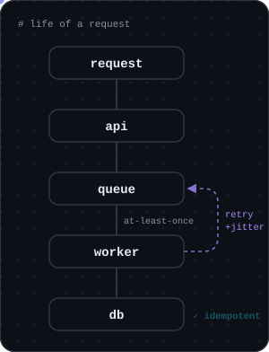
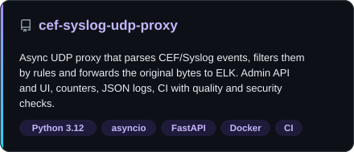
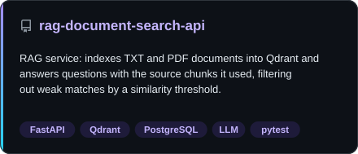
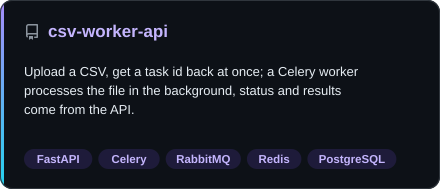
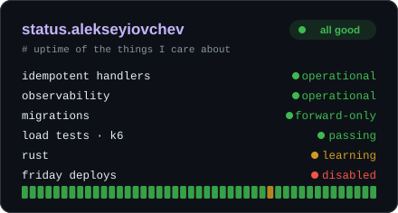

<div align="center">


<p>
  
  
  
</p>

</div>




```python
class BackendEngineer:
    name = "Oleksii Iovchev"
    role = "Backend Lead"
    experience = "5+ years"
    focus = [
        "system design",
        "distributed systems",
        "production reliability",
    ]
    learning = "Rust"
    speaks = ["EN", "UA", "FR"]
    max_retries = 3  # the fourth one is a postmortem

    def introduce(self) -> str:  # idempotent: safe to retry
        return (
            f"Hi, I'm {self.name}, {self.role.lower()}.\n"
            "I build async services and message-driven\n"
            "workflows that stay boring in production."
        )


print(BackendEngineer().introduce())
```

<br clear="right">

<p align="center">
  
</p>

### 🛠️ What I do

- 🧭 **Lead the backend of a product team**: architecture, code review, task breakdown, owning production
- ⚙️ **Async Python services**: APIs, background workers, message-driven workflows, idempotent processing
- 📈 **Reliability**: metrics, logs and alerts, load testing with k6, safe migrations and rollouts
- 🧠 **LLM and RAG pipelines**: retrieval, structured outputs, tool-calling agents over MCP
- 🦀 **A bit of Rust**: a low-latency networking side project (UDP, gRPC, Linux tuning)

> I like systems you can reason about in the middle of an incident: explicit state, idempotent steps,
> and metrics that answer the question before anyone has to ask it.

**Currently curious about:** tail latency, backpressure, and how far Rust can push a single core.


<h3 align="center">🧰 Tech stack</h3>

<p align="center">
  
  <br>
  
  <br>
  
</p>

<p align="center">
  <sub><b>also</b> · SQLAlchemy · Alembic · Pydantic · asyncio · Celery · NATS · Helm · Loki · k6 · LangChain · LangGraph · MCP · Qdrant · gRPC · Playwright · uv · ruff · pytest</sub>
</p>


<h3 align="center">📦 Selected projects</h3>

<p align="center">
  <a href="https://github.com/alekseyiovchev/cef-syslog-udp-proxy"></a>
  <a href="https://github.com/alekseyiovchev/rag-document-search-api"></a>
  <a href="https://github.com/alekseyiovchev/csv-worker-api"></a>
</p>


<h3 align="center">⚡ At a glance</h3>

<p align="center">
  
  
</p>


<p align="center">
  
</p>

<h3 align="center">🤝 Connect</h3>

<p align="center">
  <a href="https://www.linkedin.com/in/alekseyiovchev/"></a>
</p>

<p align="center"><sub>Built with ☕ and asyncio</sub></p>
